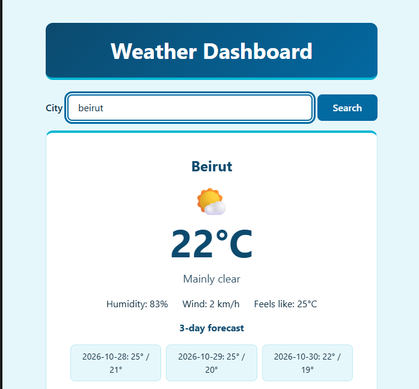
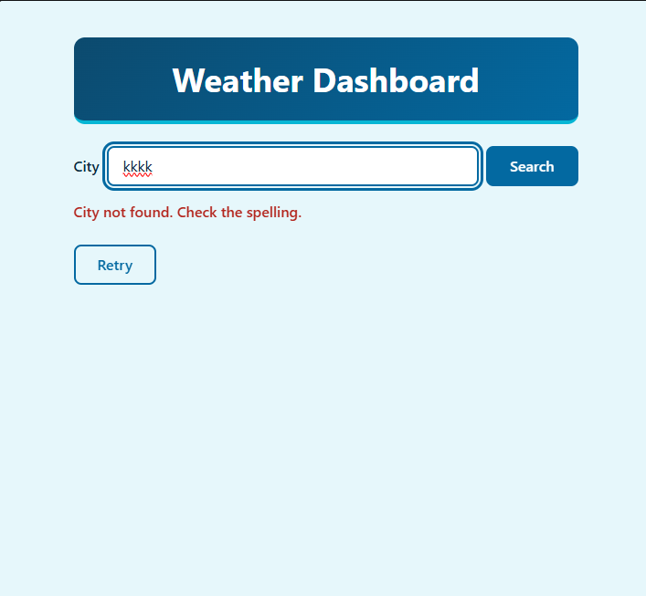

# Weather Dashboard (React)

Type a city name and get its live weather: the current conditions and a 3-day forecast. This is the Assignment 4 Weather Dashboard rebuilt as a React application with Vite, for Web Programming, Assignment 5.

## Features

- Search by city name, with the Search button or the Enter key
- Current temperature, conditions with an icon, humidity, wind speed and the "feels like" temperature
- 3-day forecast with the highest and lowest temperature of each day
- Loading state with a spinner; the Search button is disabled while a request runs
- Form validation: an empty search shows a message under the field and sends no request
- Clear error messages, with a Retry button that repeats the last search
- Responsive, mobile-first layout with one breakpoint at 600px

## Screenshots

| Beirut | City not found | Mobile |
|---|---|---|
|  |  |  |

## Getting started

You need [Node.js](https://nodejs.org) (version 20 or later) and npm.

```bash
git clone https://github.com/georges0saab/webprog-assignment5-weather-react.git
cd webprog-assignment5-weather-react
npm install
npm run dev
```

Then open the address printed in the terminal (usually http://localhost:5173).

Other scripts:

| Command | What it does |
|---|---|
| `npm run build` | Builds the app for production into `dist/` |
| `npm run preview` | Serves the production build locally |
| `npm run lint` | Checks the code with ESLint |

## API

The app uses [Open-Meteo](https://open-meteo.com), with two endpoints:

| Purpose | Endpoint |
|---|---|
| Turn a city name into latitude and longitude | `https://geocoding-api.open-meteo.com/v1/search` |
| Current weather and daily forecast | `https://api.open-meteo.com/v1/forecast` |

No API key or account is needed, so there is nothing to configure.

## Project structure

```
src/
  api/weather.js            fetching, and turning errors into messages
  utils/weatherCodes.js     weather code -> description and emoji
  components/
    SearchBar.jsx           the search form with validation
    LoadingSpinner.jsx      the loading message and spinner
    ErrorMessage.jsx        an error message with a Retry button
    WeatherCard.jsx         the current weather
    ForecastList.jsx        the 3-day forecast
  App.jsx                   state, data fetching and which state to show
  main.jsx                  entry point
  index.css                 styles
screenshots/                screenshots of the running app
```

## Components and props

```
App
├── SearchBar        onSearch, disabled
├── LoadingSpinner   message
├── ErrorMessage     message, onRetry
└── WeatherCard      data
    └── ForecastList daily
```

Data goes down through props, and events come back up through functions passed as props: `SearchBar` calls `onSearch(city)` and `ErrorMessage` calls `onRetry()`, and `App` decides what happens next.

## State management

| State | Where | Why |
|---|---|---|
| `text` (what is typed in the input) | `SearchBar` | Only the form needs it, so it stays local. |
| `error` (the validation message) | `SearchBar` | Only the form shows it. |
| `city` | `App` | Changing it starts a fetch in `useEffect`. |
| `attempt` | `App` | A counter that goes up on every search and every Retry. |
| `status` | `App` | Decides what is shown: idle, loading, ready or error. |
| `weather` | `App` | The result of the last successful search, passed to `WeatherCard`. |
| `errorMessage` | `App` | The message passed to `ErrorMessage`. |

The fetching state lives in `App` because `App` is the closest common parent of every component that uses it. The deepest prop path is `App → WeatherCard → ForecastList`, which is two levels, so there is no prop drilling.

## Data fetching with useEffect

The effect in `App` depends on `[city, attempt]`, so it runs again whenever one of them changes. It defines an `async` function inside (the effect itself is not `async`), fetches the weather in a `try/catch`, and stores either the result or the error message in state.

`attempt` is there because the effect only runs when a dependency changes. Searching the same city twice, or pressing Retry, does not change `city`, so each of them also adds 1 to `attempt` to run the effect again.

The Search button is disabled while `status` is `'loading'`, so two requests can never overlap.

## Error handling

`getJSON` wraps `fetch` in `try/catch` and checks `response.ok`, because `fetch` does not reject on HTTP errors such as 404.

| Situation | What the user sees |
|---|---|
| City not found | City not found. Check the spelling. |
| No connection (offline, DNS, CORS) | Couldn't reach the server. Check your connection. |
| Rate limit (HTTP 429) | Too many requests. Wait a moment and try again. |
| Server error (HTTP 5xx) | The weather service is having problems. Try again later. |
| Any other HTTP error | Something went wrong. Try again. |
| Empty or spaces-only input | Please enter a city name. (under the field, no request is sent) |

## Accessibility

- The input has a visible label, and every control shows a focus ring for keyboard users
- The input is marked `aria-invalid` when the form shows an error
- The emoji icon has an `aria-label` with the description of the weather
- The spinner stops for users who prefer reduced motion

## Credits

Weather data by [Open-Meteo.com](https://open-meteo.com).